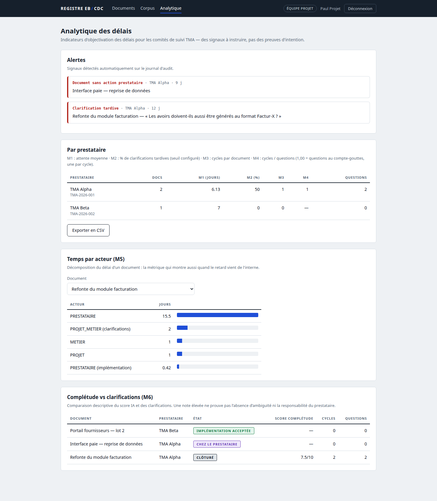
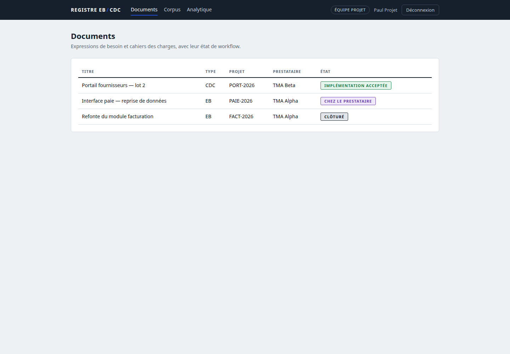
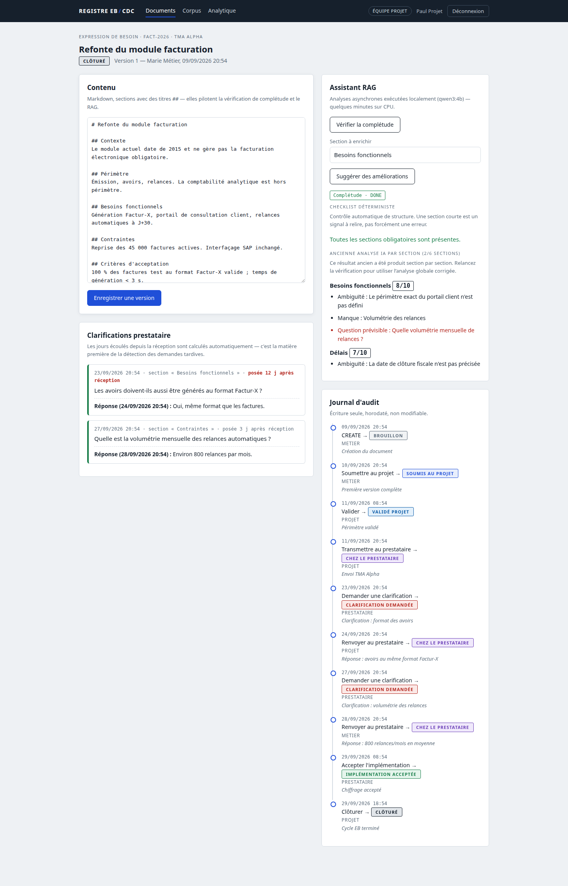
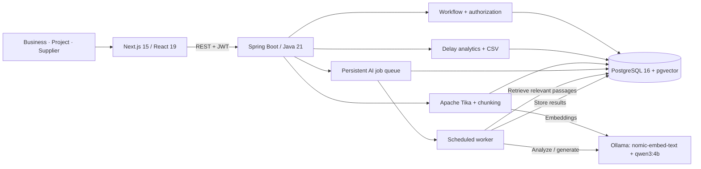
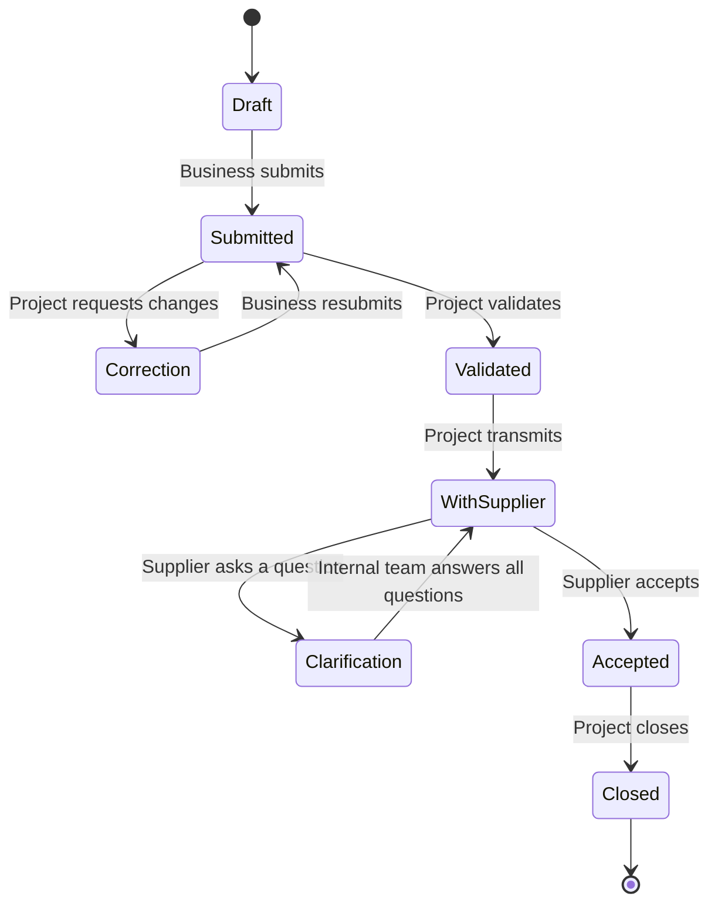

<div align="center">

# EB/CDC Assistant

### Requirements workflows. Local AI. Traceable delivery.

A full-stack application for reviewing business requirements, coordinating external suppliers, and understanding where delivery time goes.

[](https://github.com/Achraf-Tahiri/eb-cdc-assistant/actions/workflows/ci.yml)
[](backend/pom.xml)
[](frontend/package.json)
[](docker-compose.yml)
[](LICENSE)

[Features](#what-it-does) · [Screenshots](#screenshots) · [Architecture](#architecture) · [Quick start](#run-locally) · [Testing](#verification) · [Guide français](docs/README.fr.md)

</div>



## Why this project?

Business requirements often move between business teams, project managers, and external maintenance suppliers through disconnected documents and emails. Missing details create clarification loops; without a shared history, delays are difficult to explain.

**EB/CDC Assistant brings that process into one place:** versioned requirements, controlled approvals, an auditable timeline, local AI assistance, and metrics calculated from actual workflow events.

**EB** means *Expression de Besoin* (business requirements), **CDC** means *Cahier des Charges* (specification), and **TMA** refers to outsourced application maintenance. The interface and domain terminology are in French; this overview is in English.

## What it does

| Capability | Implementation |
| --- | --- |
| **Document lifecycle** | Markdown editing, version history, eight workflow states, corrections, supplier clarification loops, acceptance and closure. |
| **Role-based access** | Business, project and supplier roles; suppliers can access only documents assigned to their contract after transmission. |
| **Audit trail** | Timestamped transitions recorded in the same transaction as the state change, with pessimistic document locking. |
| **Local AI assistance** | Deterministic completeness checks plus document-wide LLM analysis; retrieval-backed suggestions with source references and similarity scores. |
| **Knowledge corpus** | Import PDF, DOCX, TXT or Markdown; extract text with Apache Tika, chunk it, embed it and search with pgvector. |
| **Delivery analytics** | Supplier waiting time, late questions, repeated clarification cycles, time per actor and CSV export. |

### Engineering highlights

- **Explicit state machine:** permitted transitions and roles are defined together and tested across the state/action/role matrix.
- **Transactional consistency:** document state, clarification handling and audit events share locking and transaction boundaries.
- **Grounded suggestions:** retrieval thresholds and server-side checks reject unknown citations, weakly supported text and repeated content. Human review remains necessary.
- **CPU-friendly AI queue:** completeness and suggestion jobs are stored in PostgreSQL and processed one at a time; the UI polls their status.
- **Local inference:** the configured Ollama models run on your machine, without a hosted LLM API key.

## Screenshots

Screenshots show the running application with the repository's **synthetic demo dataset**. The completeness report shown in the document view is seeded demonstration data, not a new model evaluation.

### Document register

Track requirements by project, supplier and workflow state.



<details>
<summary><strong>Document workspace: editor, AI report, clarifications and audit history</strong></summary>



</details>

The dashboard at the top shows supplier metrics and an actual time-by-actor bar chart computed from the seeded transition history. See [screenshot notes](docs/screenshots/README.md) for reproduction details.

## Architecture



**Retrieval pipeline:** document → Markdown-aware chunks (about 1,200 characters, 200-character overlap) → 768-dimensional embeddings → pgvector HNSW cosine search → similarity filtering → generation with retrieved context → citation and content checks.

Completeness analysis combines a required-section checklist with an LLM review of the whole document. Ingestion and semantic search are synchronous; completeness and suggestion generation use the background queue.

### Document workflow



### Technology stack

| Layer | Technologies |
| --- | --- |
| Frontend | Next.js 15.5.25, React 19, JavaScript, custom CSS |
| Backend | Java 21, Spring Boot 3.3.4, Spring Data JPA, Spring Security, JWT |
| Storage | PostgreSQL 16, pgvector, HNSW index |
| AI | Ollama, `qwen3:4b`, `nomic-embed-text` |
| Document parsing | Apache Tika |
| Tests & automation | JUnit 5, Mockito, Python HTTP regression tests, GitHub Actions |

## Run locally

### Prerequisites

- Java **21** and Maven **3.8.7+**
- Node.js **24** and npm (the version used for verification and CI)
- Docker with Docker Compose
- Ollama with the models below **for AI features**; workflow and analytics work without it

```bash
git clone https://github.com/Achraf-Tahiri/eb-cdc-assistant.git
cd eb-cdc-assistant
```

For local AI, start Ollama and download the models:

```bash
ollama pull qwen3:4b
ollama pull nomic-embed-text
```

### Quick start on Linux

```bash
# Start the database, backend and frontend, and load synthetic demo records.
EBCDC_SEED_DEMO=1 ./demarrer.sh
```

Open **http://localhost:3000**. The launcher stays in the foreground; use `Ctrl+C` or `./arreter.sh` to stop the app. Database contents persist in a Docker volume. Omit `EBCDC_SEED_DEMO=1` for an empty document register with demo accounts only.

The launcher uses Linux tools including `ss`, `setsid` and `flock`. For other environments, start each service manually:

```bash
# Terminal 1 — database on port 5433
# Run from the repository root.
docker compose up -d

# Terminal 2 — backend on port 8080
mvn -f backend/pom.xml spring-boot:run

# Terminal 3 — frontend on port 3000
npm --prefix frontend ci
npm --prefix frontend run dev
```

Once the backend has initialized the schema and accounts, optionally load the demo:

```bash
docker exec -i ebcdc-db psql -v ON_ERROR_STOP=1 -U ebcdc -d ebcdc < scripts/seed-demo.sql
```

### Demo accounts

All three use the password **`demo1234`**.

| Role | Email | Typical actions |
| --- | --- | --- |
| Business team | `metier@demo.fr` | Create requirements, edit drafts, submit, answer questions |
| Project team | `projet@demo.fr` | Validate, transmit, answer questions, close, review analytics |
| Supplier — TMA Alpha | `prestataire@demo.fr` | Review assigned documents, request clarification, accept |

**Try the full workflow:** create a document as Business and select TMA Alpha → submit → sign in as Project to validate and transmit → sign in as Supplier to ask a question → answer as an internal user → accept as Supplier → close as Project.

### Configuration

Spring Boot accepts environment-variable overrides; export them before starting the backend. A root `.env` file is **not** automatically loaded by the Java application.

| Variable | Default / purpose |
| --- | --- |
| `SPRING_DATASOURCE_URL` | `jdbc:postgresql://localhost:5433/ebcdc` |
| `SPRING_DATASOURCE_USERNAME` / `SPRING_DATASOURCE_PASSWORD` | `ebcdc` / `ebcdc` — local demonstration only |
| `APP_JWT_SECRET` | Override the development signing key with your own secret (at least 32 bytes) |
| `APP_OLLAMA_BASE_URL` | `http://localhost:11434` |
| `APP_OLLAMA_GENERATION_MODEL` | `qwen3:4b` |
| `APP_OLLAMA_EMBEDDING_MODEL` | `nomic-embed-text`; the schema expects 768-dimensional embeddings |
| `NEXT_PUBLIC_API_URL` | `http://localhost:8080`; configure in `frontend/.env.local` and rebuild/restart Next.js |

See [application.yml](backend/src/main/resources/application.yml) for retrieval and clarification thresholds, and [frontend/.env.example](frontend/.env.example) for the frontend template. Browser CORS currently allows `http://localhost:3000`.

## Verification

Verified locally on **29 September 2026**:

| Check | Result |
| --- | --- |
| Backend unit and parameterized tests | **230 passed**, no failures or skipped tests |
| Frontend production build | **Passed** |
| HTTP API regression suite | **21 passed** against a disposable database |
| Browser smoke check | Login, register, document detail and analytics rendered; no uncaught page errors |

Most Java test cases exercise the transition matrix; the count is not a claim of 230 end-to-end user journeys. GitHub Actions runs the Java tests, HTTP regression suite and frontend build on pushes to `main` and pull requests. AI inference is not part of CI.

```bash
mvn -B -f backend/pom.xml verify
npm --prefix frontend ci
npm --prefix frontend run build
```

See [testing and reproducibility](docs/TESTING.md) for disposable-database HTTP tests, optional AI checks and the distinction between current verification and the historical audit.

## Analytics at a glance

| Metric | Meaning |
| --- | --- |
| M1 | Average supplier waiting interval in days |
| M2 | Percentage of clarification requests made after the configured delay threshold |
| M3 | Average clarification cycles per document |
| M4 | Cycles-to-questions ratio; a high ratio can indicate fragmented questioning |
| M5 | Elapsed time by actor for a selected document |
| M6 | Descriptive comparison of completeness scores and clarification counts |

Alerts flag dormant documents, late clarifications and repeated cycles. These are signals for review: **they do not establish fault or prove that a model score predicts delivery quality**.

## Project structure

```text
backend/
  src/main/java/com/ebcdc/assistant/
    auth/         JWT authentication
    workflow/     State machine and transaction rules
    rag/          Ingestion, retrieval and AI jobs
    analytics/    Metrics and alert queries
    web/          REST controllers
  src/main/resources/   Configuration and SQL schema
  src/test/             Java regression tests
frontend/
  app/            Login, documents, corpus and analytics pages
  components/     Navigation and workflow state badges
  lib/            API client and session helpers
scripts/          Demo SQL, HTTP tests and process cleanup
docs/             Guides, audit, testing notes and screenshots
.github/workflows/ci.yml
```

## Scope and next steps

This is a **local portfolio prototype**. It ships with public demo credentials and a development JWT key, and is not hardened for internet-facing deployment. See [SECURITY.md](SECURITY.md) and the [detailed audit](docs/AUDIT.md).

Planned improvements:

- [ ] Production account provisioning, login rate limiting and configurable deployment origins
- [ ] Recovery for interrupted AI jobs and coordination across multiple workers
- [ ] Corpus deletion/version management and stronger document-revision policies
- [ ] Retrieval and answer-quality evaluation against an annotated dataset
- [ ] Broader accessibility, mobile and resilience testing

## Documentation & contributing

- [French setup and feature guide](docs/README.fr.md)
- [Hands-on walkthrough — French](docs/COMPRENDRE-ET-TESTER.md)
- [Testing guide](docs/TESTING.md)
- [Historical technical audit and known limitations — French](docs/AUDIT.md)
- [Contributing](CONTRIBUTING.md)

## Author & license

Built by **[Achraf Tahiri](https://github.com/Achraf-Tahiri)**.

Released under the [MIT License](LICENSE).
