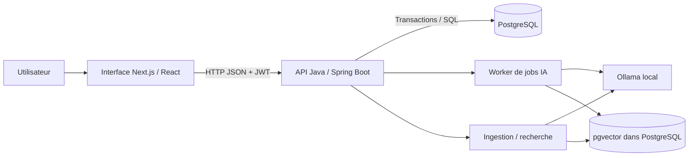
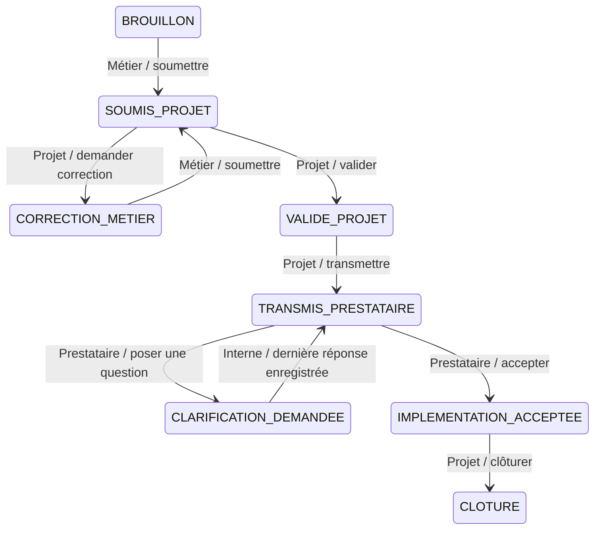

# Comprendre et tester l’assistant EB/CDC

Ce guide décrit le code examiné le 9 septembre 2026. Les preuves et réserves se trouvent dans [AUDIT.md](AUDIT.md). Le dossier historique à la racine est plus détaillé, mais certaines de ses affirmations sont devenues obsolètes.

## 1. Le problème que le projet cherche à résoudre

Une équipe exprime un besoin informatique. L’équipe projet le vérifie puis le transmet à un prestataire. Celui-ci peut demander des précisions avant d’accepter. Les échanges dispersés rendent difficile la compréhension des délais.

L’application centralise ces documents, conserve leurs versions et mesure le temps passé à chaque étape. Une assistance IA aide à repérer des informations manquantes et à réutiliser des exemples historiques.

- **EB : expression de besoin.** Ce que l’organisation veut obtenir et pourquoi.
- **CDC : cahier des charges.** Exigences et contraintes attendues pour réaliser ce besoin.
- **TMA : tierce maintenance applicative.** Maintenance confiée à un prestataire extérieur.

Dans ce prototype, EB et CDC sont deux valeurs d’un champ : ils utilisent le même modèle de sections, les mêmes règles de complétude et le même workflow. Ne pas annoncer deux moteurs métier différents.

## 2. Trois blocs à distinguer

| Bloc | Fonction | Utilise-t-il un modèle IA ? |
|---|---|---|
| Workflow | Autoriser les actions, changer d’état, conserver l’historique | Non |
| Assistance documentaire | Vérifier la structure, analyser les sections, suggérer du texte | Règles classiques + modèles locaux |
| Analytique | Calculer les durées, cycles, ratios et alertes | SQL ; M6 réutilise des notes du modèle |

Le workflow reste utilisable sans Ollama. Les opérations qui demandent des embeddings ou une génération échouent si Ollama est indisponible. La checklist est indépendante du modèle dans le code, mais l’API actuelle l’intègre dans un job de complétude : il n’existe pas de bouton séparé « checklist seule ».

## 3. Architecture et trajet d’une action

Exemple : Marie clique sur **Soumettre au projet**.

1. Le navigateur envoie `POST /api/documents/{id}/actions` avec `SUBMIT` et son jeton JWT.
2. `JwtAuthFilter` vérifie le jeton et retrouve Marie dans la base.
3. `DocumentController` transmet la demande à `WorkflowService`.
4. Le service verrouille le document et vérifie son état et le rôle de Marie.
5. Dans une seule transaction, il change l’état et ajoute une transition horodatée.
6. L’API renvoie le nouvel état ; l’interface recharge le document et les actions disponibles.

**Transaction** : les modifications réussissent ensemble ou sont annulées ensemble. **Verrou** : deux requêtes concurrentes ne peuvent pas modifier simultanément le même document. Le navigateur masque certains boutons pour l’ergonomie ; c’est le backend qui impose réellement les permissions.

## 4. Le workflow à savoir expliquer

Il y a huit états et neuf règles de transition. `CREATE` est une trace initiale, pas un déplacement vers un autre état.

Deux questions posées avant que l’équipe interne ait terminé ses réponses constituent **un cycle, deux questions**. Une nouvelle question après le retour au prestataire commence un nouveau cycle. Le délai d’une question est mesuré depuis la dernière transmission ou le dernier retour au prestataire, pas depuis la création du document.

Un prestataire ne voit que les documents de son contrat et seulement à partir de la transmission. Les équipes internes voient tous les documents. Le métier peut modifier un brouillon, une correction ou un document en clarification. Le projet conserve actuellement des droits d’édition dans tous les états : cette règle mérite validation métier, notamment après clôture.

## 5. Où sont les informations ?

| Table | Question à laquelle elle répond |
|---|---|
| `users` | Qui agit et avec quel rôle ? |
| `providers` | Pour quel prestataire et quel contrat ? |
| `documents` | Quel document, quel état actuel ? |
| `document_versions` | Quels contenus ont été enregistrés ? |
| `workflow_transitions` | Quelle action, par quel rôle, à quel moment ? |
| `clarification_requests` | Quelle question, quelle réponse, quel délai ? |
| `rag_chunks` | Quels passages historiques et quels vecteurs ? |
| `rag_jobs` | Quelle analyse demandée, quel statut et quel résultat ? |

Enregistrer une version ne crée pas une transition de workflow. Répondre à une clarification ne modifie pas automatiquement le contenu du document. L’historique des versions existe dans la base, mais l’interface ne permet pas encore de relire toutes les anciennes versions.

Le journal est protégé par les possibilités de l’API. Il n’est pas inviolable : un administrateur de la base peut le modifier. La suppression autorisée d’un brouillon efface sa trace initiale.

## 6. Le RAG et les modèles

**RAG = Retrieval-Augmented Generation**, génération enrichie par des documents retrouvés.

1. Tika extrait le texte d’un fichier, ou l’utilisateur colle du texte.
2. Le code découpe le texte en sections puis en passages de 1 200 caractères, avec 200 caractères de chevauchement.
3. `nomic-embed-text` transforme chaque passage en un vecteur de 768 nombres.
4. PostgreSQL et pgvector conservent le texte, sa source et son vecteur.
5. Pour une suggestion, le titre de section et le brouillon sont également transformés en vecteur.
6. La recherche examine les passages les plus proches et garde au maximum cinq résultats dont le score atteint le seuil configuré (0,55 par défaut).
7. `qwen3:4b` reçoit ces passages, le brouillon et le document actuel complet afin de proposer uniquement des informations absentes.
8. Le modèle cite les sources par numéro. Le serveur remplace ensuite ces numéros par les vrais noms et scores issus de PostgreSQL ; il retire les références invalides, les ajouts mal soutenus et les reformulations déjà présentes.
9. Si aucun ajout ne passe ces contrôles, l’écran l’indique clairement. Sinon, l’utilisateur relit la suggestion, peut l’insérer, puis enregistre une version.

**Aucun entraînement ni fine-tuning n’est implémenté.** Importer un document ajoute des données à l’index ; cela ne modifie pas les poids du modèle. Réimporter le même nom de source remplace ses passages précédents. Un score de similarité n’est pas une probabilité que la réponse soit vraie.

La complétude suit un autre chemin : checklist de six titres obligatoires et repère de 200 caractères par section ; puis évaluation globale des sections non vides par le LLM. Le document entier lui est fourni pour éviter de réclamer une information déjà écrite ailleurs. Elle ne consulte pas le corpus vectoriel. Au maximum six sections sont notées, chaque section est limitée à 3 000 caractères et le contexte total à 18 000 caractères. Un long document n’est donc pas forcément évalué intégralement. Le repère de 200 caractères attire l’attention sur une section courte, sans prouver qu’elle est incomplète.

Le worker traite les jobs l’un après l’autre dans une instance du backend. L’ingestion et la recherche sont synchrones et n’utilisent pas cette file. Plusieurs instances du backend ne sont pas prises en charge de manière fiable par le mécanisme actuel.

## 7. Les métriques, avec leurs limites

| Mesure | Calcul actuel | Interprétation prudente |
|---|---|---|
| M1 | Moyenne des intervalles en `TRANSMIS_PRESTATAIRE` | Attente moyenne par passage chez le prestataire ; inclut les attentes en cours |
| M2 | Questions posées au-delà du seuil / nombre de questions × 100 | Fréquence des questions tardives ; seuil 5 jours par défaut |
| M3 | Cycles / documents affectés au prestataire | Le dénominateur inclut aussi les brouillons affectés |
| M4 | Cycles / questions | 1 signifie une question par cycle, sans démontrer une intention |
| M5 | Somme des durées entre transitions, regroupées selon l’état | Temps écoulé, pas temps de travail effectivement consommé |
| M6 | Tableau de la note moyenne des sections et du nombre de cycles | Comparaison descriptive ; aucun coefficient statistique ni causalité |

Exemple M1 : attentes de 6, 2, 0 et 4 jours → `(6 + 2 + 0 + 4) / 4 = 3 jours`.
Exemple M4 : deux cycles et trois questions → `2 / 3 = 0,67`.

Un score IA élevé peut être erroné. M6 utilise le dernier rapport terminé, qui peut concerner une autre version ou une analyse faite après les clarifications. Le rapport de complétude du jeu de démonstration est **simulé**, pas produit par Ollama.

## 8. Manipulation guidée à refaire soi-même

L’application laissée en fonctionnement utilise `ebcdc_test_pedagogie`. La base d’origine `ebcdc` est conservée. Ne lancez pas les scripts de régression sur cette base pédagogique si vous souhaitez garder une liste courte : ils créent beaucoup de documents.

Ouvrir http://localhost:3000. Tous les mots de passe démo sont `demo1234`.

| Étape | Compte | Manipulation | Résultat à observer |
|---|---|---|---|
| 1 | `metier@demo.fr` | Créer « Exercice personnel », choisir TMA Alpha | Brouillon, version 1, trace CREATE |
| 2 | Métier | Écrire six sections, enregistrer | Version 2, état inchangé |
| 3 | Métier | Lancer la complétude | PENDING → RUNNING → DONE ou message d’échec |
| 4 | Métier | Soumettre | Soumis au projet ; édition métier bloquée |
| 5 | `projet@demo.fr` | Valider puis transmettre | Chez le prestataire |
| 6 | `prestataire@demo.fr` | Poser deux questions | Un seul cycle de clarification |
| 7 | Projet | Répondre à la première question | Le document reste en clarification |
| 8 | Projet | Répondre à la deuxième | Retour automatique chez le prestataire |
| 9 | Prestataire | Accepter | Implémentation acceptée |
| 10 | Projet | Clôturer et consulter l’analytique | Journal complet et métriques mises à jour |

Pour l’IA, comparer une section vague (« le système doit être rapide ») à une exigence mesurable (« 95 % des recherches sous 2 s sur 10 000 factures »). Vérifier chaque remarque : est-elle pertinente, déjà renseignée, hors périmètre ou inventée ?

Pour les suggestions, ouvrir Corpus, indexer un exemple synthétique puis rechercher une notion présente dans cet exemple. Enfin demander une amélioration d’une section. Identifier ce qui provient réellement de la source et ce qui a été ajouté par le modèle.

Après chaque manipulation, répondre sans lire le code : **quelle requête a été envoyée ? quelle table a changé ? quelle règle empêche un autre rôle de faire la même chose ?**

## 9. Parcours de lecture du code

1. `backend/.../domain/WorkflowState.java`, `WorkflowAction.java`, `Role.java` : vocabulaire métier.
2. `workflow/WorkflowService.java` : règles et transaction.
3. `web/DocumentController.java` : relier les routes aux actions de l’écran.
4. `frontend/lib/api.js`, puis `frontend/app/documents/[id]/page.js` : aller-retour navigateur/API.
5. `rag/ChunkingService.java`, `CompletenessChecker.java` : règles déterministes faciles à vérifier.
6. `rag/IngestionService.java`, `RagVectorStore.java`, `OllamaClient.java` : chaîne de recherche.
7. `rag/RagJobWorker.java` : exécution, prompts et résultats.
8. `analytics/AnalyticsService.java` : calculs SQL et leurs dénominateurs.
9. `backend/src/test` et `scripts/test-api.py` : spécifications exécutables.

`backend/...` désigne ici `backend/src/main/java/com/ebcdc/assistant/`.

## 10. Présentation de cinq minutes

- **Problème :** suivre les échanges autour des besoins et rendre les délais explicables.
- **Démonstration :** un document passe entre trois rôles ; une clarification complète le besoin ; le journal garde les étapes.
- **Architecture :** interface React, API Spring Boot, PostgreSQL et modèles Ollama locaux.
- **Apport IA :** aide à la rédaction et à la relecture, avec décision humaine finale.
- **Validation :** tests métier, appels HTTP, concurrence, calculs connus et essais réels du pipeline IA. Montrer les preuves, pas seulement annoncer « ça fonctionne ».
- **Limites :** prototype local, qualité IA non benchmarkée, notes indicatives et travail restant avant production.

Formulation honnête sur l’IA de développement : « Le code a été réalisé avec une forte assistance IA. J’ai ensuite repris les règles métier, ajouté des tests et corrigé des défauts reproductibles pour pouvoir expliquer et vérifier son fonctionnement. » Adapter cette phrase uniquement à ce que vous avez effectivement compris et refait.

Ne pas annoncer : « mon système détecte les prestataires mal intentionnés », « le RAG empêche les hallucinations », « le modèle a été entraîné sur nos documents », ou « tous les cas possibles ont été testés ».
